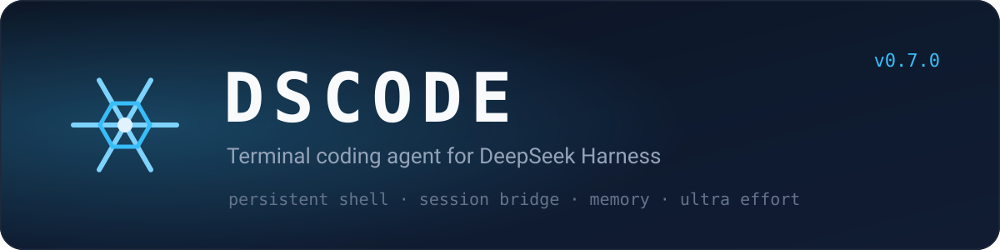
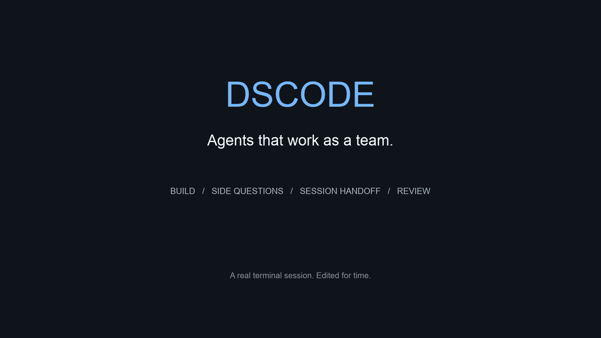

<div align="center">



# ❄ DSCODE

**在终端里写代码，让脚本接入当前会话，让 agent 之间交接任务。**




[](https://github.com/qiz029/dscode/releases)
[](https://github.com/qiz029/dscode/stargazers)
[](https://github.com/qiz029/dscode/discussions)

[English](README.md) · [简体中文](README.zh-CN.md)

[核心能力](#-核心能力) · [最新变化](#-最新变化) · [快速开始](#-快速开始) · [常用命令](#-常用命令) · [更新日志](docs/CHANGELOG.md) · [文档](#-文档)

</div>

DSCODE 是基于 [DeepSeek Harness](https://github.com/deepseek-ai/deepseek-harness) 的 macOS 与 Linux 终端编码 agent。专用文件工具通过文件版本检查来读取和编辑代码，持久 Shell 负责搜索、构建和测试。TUI、CLI 与脚本共用同一个会话运行时，而不是各自启动一套。它以固定版本的可复现 harness 安装——DSH 依赖、TUI 与插件一起打包、一起校验。

多数编码 agent 是单打独斗。DSCODE 建在相反的假设上：同一台机器上的会话**彼此可见**——一个可以把任务交出去，另一个可以审阅 diff，而放行与否由一个独立审核模型按**你的指令**判断，而不是查规则表。

**60 秒看懂**——三件多数编码 agent 做不到的事，以及在哪里看：

| 在一个终端里 | 说明 |
|---|---|
| `/btw 第一轮为什么缓存是冷的？` | 旁支问题在独立、只读的子会话里跑，答案只在面板里出现，不进入主线对话。 |
| `dscode send <会话 id> --steer "review parser.ts 的改动并回复"` | 把活交给同一台机器上的另一个会话；它能读你的 transcript、回复、把结论交回来。 |
| `/permission auto-review` · `/review-usage` | 由独立审核模型按你的指令决定放行，并留下它放行了什么、花了多少的记录。 |

[演示指南](docs/demo.md) 总结 DSCODE 的功能，提供五分钟 Desktop 演示草稿，并保留 90 秒终端演示的分镜与录制命令。

## 🧭 核心能力

| 能力 | 说明 |
|---|---|
| **[编码循环](docs/dscode-ultra.md)** | 有界、带缓存的文件读取，单文件批量编辑与原子写入，保留旧版本保护和 diff 元数据。持久 Bash 会保存较大的捕获结果，供后续按需读取。项目指令、skills、plan、goal 与 hooks 已接入。 |
| **[后台 Host](docs/host.md)** | 终端与 agent 运行时分成两个进程：第一个 `dscode` 会启动本地后台 Host 来持有会话，每个终端作为客户端接入。关闭终端不会中断工作，多个终端可接入同一会话，崩溃的终端可以重新接入。用 `dscode host status/stop` 管理；`--in-process` 保留单进程模式。 |
| **[远程 Runtime](docs/remote-runtime.md)** | 运行时跑在服务器上（`dscode server --port 8080`），终端跑在本机：`dscode config --runtime host:8080 --token … --alias devbox --set-default`，之后用 `dscode` 或 `dscode runtime devbox` 连接。长期运行可用 `dscode server install --port 8080`，再执行 `dscode server start`；用 `dscode server status/logs` 查看状态和日志。协议兼容时允许客户端与服务端应用版本不同。用 `dscode runtime status devbox` 或 `dscode runtime doctor devbox` 检查远端（均支持 `--json`）；用 `dscode config --alias devbox` 更新个别连接配置。底栏持续标识远端机器与连接状态；断网会自动重连，认证或版本错误则需要处理。服务重启后写入会自动恢复会话；请求 ID 防止重试重复投递，中断针对已观察到的 turn，删除前检查存储写入所有权。工具、文件和凭据都留在服务器上。使用 token 认证但不加密，请在 VPN、内网或 SSH 隧道中使用。 在 `server` 或 `server install` 后加 `--yolo`，可让所有服务端会话免确认使用文件、Shell、浏览器和桌面工具；系统权限仍需授予。去掉该参数重启后恢复普通权限策略。 |
| **[会话接入](docs/session-bridge.md)** | 在 TUI 开始任务后，可从另一个终端补充要求、读取输出或订阅进展（`dscode sessions`、`send`、`read`、`watch`）。所有来源进入同一个运行时和上下文，读取和订阅不需要取得 session 写锁。 |
| **[Agent 间任务](docs/session-communication.md)** | Agent 通过 `list_sessions`、`read_session`、`send_session` 与 `reply_session` 查找、读取并联系其他会话，投递方式可选 `queue`、`steer` 或 `defer`。持久化邮箱、重试去重和有限预算约束消息丢失、重复处理和互相唤醒。 |
| **[会话名片](docs/session-cards.md)** | 每个 session 展示项目、工作区与最近 5 条用户请求 topic，选协作对象时不必先读它的记录。名片描述用户让它做过什么，不放任务结论。 |
| **[跨会话记忆](docs/memory.md)** | 后台提取可复用经验，检索时一并给出工作区和来源消息。支持按 session 或全局关闭，后台模型用量单独统计。 |
| **[推理强度与子 agent](docs/dscode-ultra.md)** | Ultra 使用模型的 `max` 推理，自行决定调查、委派和验证的范围；低于 Ultra 时也能委派，但只在任务确实需要时才用。父 agent 可为每个子 agent 单独选择 effort，需要编辑的子 agent 可从干净的 `HEAD` 建立隔离 Git worktree。 |
| **[独立审查](docs/tui-commands.md)** | 代码改动通过相关检查后，agent 会把 Git diff（非 Git 工作区则是相对任务开始时快照的改动）交给独立的只读模型审查，先修复具体发现再结束本轮。`/review` 可手动触发，范围可选暂存区、基准分支、单次提交或路径。 |
| **[非交互执行](docs/exec.md)** | `dscode exec "prompt"`，或 `git diff \| dscode exec "review this"`，在脚本和 CI 中跑完整一轮：回复流式输出到 stdout，工具活动和 session id 到 stderr，退出码反映轮次结果，支持 `--json` 与 `--resume`。 |
| **[终端体验](docs/session-metrics.md)** | 六种界面语言、可选中复制、向上滚动历史、直接显示工具失败和文件修改摘要、可展开的 diff、固定在底部的输入区、子 agent 概览，以及底栏 TPS / context / 费用 / 缓存指标。带边框的欢迎卡片和铺满终端高度的布局让输入区从启动起就固定在底部。默认主题采用对齐正文和克制配色；Prismatic 与 Rainbow 增加装饰动画。活动栏显示当前目标与本次工具耗时；verbose 模式展示思考和调用详情。缓存余额保留币种，并区分账户资金与 key 额度。 |
| **[权限护栏](docs/auto-review.md)** | 默认 `workspace-write` sandbox 与独立模型 Auto 审核，可切回人工审批。Ultra 不增加权限，Computer Use 保留人工授权。 |
| **[Agent 邮件](docs/email.md)** | 所有 session 共用的本地 `[ToAgent]` 收件箱：Enter 把邮件作为用户选择的上下文 steer 进当前会话；配置 Gmail 后 agent 可走同一审批流程发信。 |

## 🆕 最新变化

**0.7.51** — 终端升级至 Harness `0.2.1-rc.3`，新增批量编辑、有界缓存读取和大段 Bash 输出落盘。`server --yolo` 支持无人值守运行；Linux 新增局部桌面观察、动作结果检查、控制租约和 server 专用桌面。Wayland 串流控制仍为实验性功能。详见[发布说明](docs/releases/0.7.51.md)。

**0.7.50** — 远端 server 支持作为 macOS 或 Linux 用户服务运行，启动时验证鉴权就绪，更新时安全暂停并恢复服务。新增远端状态、诊断与持续可见的连接身份。server 重启后会话写入可自动恢复，投递请求 ID 防止重试重复，打断可锁定观察到的轮次，删除操作检查存储写入归属。两端需要使用相同的协议修订版和固定 Harness 版本。详见[发布说明](docs/releases/0.7.50.md)。

**0.7.49** — 终端升级到 Harness `0.2.1-rc.2`，这是 DeepSeek 为 DeepSeek-V4.1-Flash-1017 推荐的版本；Desktop 组合包仍为 `0.2.0-rc.2`。子 agent 现在一律在后台启动，结束后再向父 agent 汇报。在 OpenRouter 和 OpenCode Go 上，`deepseek-flash` 会切到 V4.1 Flash，而不是已退役的 V4 Flash。后台记忆不再因自身的输出上限而失败。详见[发布说明](docs/releases/0.7.49.md)。

**0.7.48** — [远程 Runtime](docs/remote-runtime.md)：`dscode server --port PORT` 通过 TCP 并以 token 认证对外提供本机运行时，另一台机器上用 `dscode config --runtime` / `dscode runtime <别名>` 连接终端。粘贴的文件会上传，`/diff`、`/review` 和 `/export` 在服务器上的目录中执行，连接断开后终端会自动重连。连接不加密。`/reload` 无需重启运行时即可应用 MCP 与配置修改、祖先 skill 和指令。详见[发布说明](docs/releases/0.7.48.md)。

**0.7.47** — 终端与 agent 运行时现在分为两个进程：`dscode` 会启动本地[后台 Host](docs/host.md) 来持有会话，终端通过仅限本人访问的 socket 接入。关闭或崩溃的终端不会中断 Host 上正在运行的工作，多个终端可以接入同一会话，每个会话沿用自己目录的指令。`--in-process` 可恢复单进程模式。详见[发布说明](docs/releases/0.7.47.md)。

**0.7.46** — 新增 64 位 glibc Linux（x64 与 arm64）自包含安装包。同一条 `curl` 安装命令、`dscode update` 和直接下载现已支持 Linux；请安装 bubblewrap 以启用命令沙箱。详见[发布说明](docs/releases/0.7.46.md)。

**0.7.45** — Antigravity 接入可识别 Gemini 4 Argon，并改用模型的 `thinkingLevel` 选择 low/medium/high 推理档位，不再发送 Argon 会拒绝的思考预算。访问资格由 Google 按账户决定，Argon 线上生成尚未验证。详见[发布说明](docs/releases/0.7.45.md)。

**0.7.44** — 新增原生 OpenAI/ChatGPT 与社区 Antigravity Gemini 接入、带文件版本检查的 read/edit/write 工具，更清晰的全高度终端布局，以及可靠的非交互持久 Bash 命令。OpenAI 速度选择会报告服务器实际档位；Antigravity 账户访问仍需线上验证。详见[发布说明](docs/releases/0.7.44.md)。

**0.7.42** — 修复完整安装包升级时的文件列表缓冲区限制。已装 0.7.41 的用户请重新运行下方 `curl` 安装命令一次，之后可正常使用 `dscode update`。详见[发布说明](docs/releases/0.7.42.md)。

**0.7.41** — 终端改为一个自包含包，自带运行环境和原生依赖。安装与升级不再依赖 npm 或 Hub；用户数据独立保存，与已有 DSH 安装互不依赖。详见[发布说明](docs/releases/0.7.41.md)。

**0.7.40** — 凭据变更或删除后清除余额缓存，保留币种并区分账户余额与 key 限额；TUI 和 ACP 新增实时查询的 `/status`。ACP 同时按已配置凭据筛选模型，并在失败时提供重试提示。详见[发布说明](docs/releases/0.7.40.md)。

**0.7.39** — 修复发布包中的 DeepSeek provider 启动问题。终端升级到 Harness `0.2.0-rc.2` 和 Computer Use `0.3.3`，适配原生提醒投递与 `/schedule` 列表，并提供可选的 Atomic Mail MCP 配置。未配置或禁用时，不向模型上下文加入 Atomic Mail 工具和服务器指令。详见[发布说明](docs/releases/0.7.39.md)。

**0.7.36** — `dscode acp` 让 ACP 客户端使用 DSCODE agent preset、已配置的模型服务和客户端工具审批。安装 npm `latest` 启动器后，将客户端命令配置为 `dscode`，参数为 `["acp"]`。协议支持范围见 [ACP 指南](docs/acp.md)，详见[发布说明](docs/releases/0.7.36.md)。

**0.7.35** — 移除 Hub 捆绑，将桌面浏览器工具限定于 DSCODE 会话，并统一设置页与启用指引的 Harness 风格。已有桌面模型和账户可继续使用，TUI Browser Use 保留。详见[发布说明](docs/releases/0.7.35.md)。

**0.7.32** — OpenCode Go 改为只用 OpenCode 账号登录：`/opencode login` 显示验证码、打开控制台，并在后台完成登录。登录会自动续期，请求发往控制台为你的组织指定的推理地址。0.7.31 用的控制台 API key 不再读取，请运行一次 `/opencode login`。状态栏显示订阅在 5 小时、每周、每月三档额度中的用量，某档用尽时显示何时恢复。授权页显示的是 OpenCode CLI，因为 DSCODE 借用了它的登录客户端。

**0.7.31** — OpenCode Go 加入 `/provider`：`/provider opencode-go` 保存 OpenCode 控制台发放的 key，提供 Go 的 chat-completions 模型——DeepSeek、GLM、Kimi、MiMo、LongCat、Hy 和 Space Bunny——每个模型的推理强度都按线上网关实测结果提供，请求带上 Go 要求的会话 ID，工具调用之间会回传思考内容。Go 会话的联网搜索和 OpenCode 一样走 Exa，不需要额外的 key。Qwen、MiniMax 以及 Go 上的 Grok、GPT 模型走其他协议，暂未提供。

**0.7.30** — `/delegate <任务>` 让主 agent 成为协调者：先在看板上按优先级和依赖规划任务，把就绪的部分派给隔离 Git worktree 中的子 agent，逐个验证结果，再按依赖顺序把通过的改动合并并暂存（不提交）。`/delegate-dashboard` 用彩色看板展示待分配、进行中、验证中、已完成四列。子 agent 并发上限改为非 Ultra 5 个、Ultra 20 个；欢迎界面的雪花重新绘制。

**0.7.29** — `/account` 用系统浏览器以 DeepSeek 账号给 DeepSeek 路由授权：凭据存在本机，已登录的机器不再需要 `DEEPSEEK_API_KEY`；该命令同时可查看账号身份、充值余额与赠额，并支持退出登录。profile 为此组合了一个回环回调服务，且只在登录进行期间存在路由，`DSCODE_ACCOUNT_LOGIN=0` 可移除它。随之修复两处组合：上游改名让禁用补丁静默失效后，host 层的 workflow 引擎重新被关闭；base 已自带 PTC 运行时，冗余的那行也删掉了。

**0.7.28** — DSH 运行时从 `0.1.5-rc.2` 升到 `0.1.7-alpha.2`，带来重试 shell 上带理由的沙箱提权、持久化图片 offload、MCP 资源工具、子代理权限继承与压缩重试恢复。**复核权限预设由 `auto` 改名为 `auto-review`**，因为 DSH 已把 `auto` 保留给自己的集成：请使用 `/permission auto-review`、`dscode exec --permission auto-review` 与 `permission: auto-review`。Computer Use 的现场激活与原生 helper 不受影响，但恢复会话后需重新加载 `computer-use` skill 才会恢复其执行工具。

**0.7.27** — 修复首次 Hub 安装因 Harness 生成空 `cordis.yml` 而失败的问题。Launcher 携带针对性修复的 Hub CLI；发布验证新增原生锁文件安装、launcher 首次启动及 Hub doctor 检查。

**0.7.26** — Trigger 支持每次新建或复用 session、持久化 cron 和 delay job，以及受监管的脚本事件源；可通过 `/trigger`、CLI 或 agent 工具管理，共用工作区和审批边界。TUI 固定为 DSCODE 模式，切换模型时不支持的 effort 会回到目标默认值。TPS 使用接口返回的 token 数，按 request 次数做指数平滑；运行指标和 skills 在左侧，费用、DeepSeek 余额、峰谷和缓存率靠右，窄屏时整组移到第三行。OpenRouter 内容策略拒绝也会明确说明回合停止的原因。

**0.7.25** — 再次运行安装器不再一律拒绝，而是让 tar 安装保持最新：旧版本交给它自己的 `dscode update`（迁移状态，旧目录保留为 `.dscode-backup-<版本>`），相同或更新则只报告、不做改动，不是安装器创建的路径仍然带着它找到的路径拒绝。安装方式新增 Homebrew——`brew tap qiz029/tap && brew trust qiz029/tap && brew install dscode` 装的是同一个 launcher，且该方式下 `dscode update` 只更新 Hub profile，launcher 由 `brew upgrade dscode` 负责。

**0.7.24** — 事件现在可以无人值守地启动 session：触发器定义放在 `<state>/triggers/` 和 `<workspace>/.dsh/triggers/`，事件只携带数据且必须带 `eventId`，用 `dscode trigger` / `/triggers` 运行和查看，`trigger install` 会写入 launchd LaunchAgent——运行失败目前还没有任何通知。`/goal[20]` 可在命令面板设置或重设目标的轮次上限。OpenRouter 侧，MiMo V2.6（pro、flash、ultraspeed）加入回传思考的模型行列，`/model` 改为精选 28 个模型——五个已调优家族加 Anthropic、OpenAI、Google、xAI 的旗舰线——而不是全部 373 个可调用模型；已在清单外模型上的会话仍可继续运行。

每次发布的完整记录见 **[更新日志](docs/CHANGELOG.md)**，更详细的说明见 [0.7.29 更新说明](docs/releases/0.7.29.md)。

## 🚀 快速开始

需要 **macOS 14+** 或 **使用 glibc 的 64 位 Linux**（x64 或 arm64；不支持 Alpine 等 musl 发行版）。在 Linux 上请安装 bubblewrap（`apt install bubblewrap`、`dnf install bubblewrap`），让命令在沙箱中运行；未安装时 DSCODE 退而使用 Landlock，两者都不可用时拒绝执行需要沙箱的命令。浏览器任务另需 Google Chrome，Git 用于代码仓库及补丁操作。**无需安装 Node、npm、pnpm 或 DSH。**

**一条命令安装：**

```sh
curl -fsSL https://raw.githubusercontent.com/qiz029/dscode/main/install.sh | sh
```

安装器自动识别 macOS 或 Linux 及处理器架构，下载最新的自包含发布包并验证 SHA-256 校验和。完整程序安装到 `~/.local/share/dscode-app`，命令链接位于 `~/.local/bin/dscode`。安装后，在项目目录运行 `dscode` 即可。如果 `~/.local/bin` 不在 PATH 中，请将下面这行加入 shell 配置，并在当前终端执行一次：

```sh
export PATH="$HOME/.local/bin:$PATH"
```

包内自带固定版本的 Node、Harness、TUI、插件及原生依赖，首次启动不会通过 npm 或 Hub 安装运行环境。已有的 `dsh` 命令和 `~/.dsh` 保持不变；DSCODE 的数据独立保存在 `~/.local/share/dscode-state`。

**直接升级：**

```sh
dscode update             # 升级到最新的自包含发布版
dscode update 0.7.47      # 安装指定的自包含发布版
```

先退出正在运行的 DSCODE 会话和调度器。升级器校验后整体替换程序，保留设置、凭据和会话；替换失败会恢复旧程序。在 TUI 中输入 `/update`，会安排在退出后执行同一个升级器。再次运行安装命令，也会升级由该安装器管理的安装。

**从旧安装迁移？** 旧 npm/Hub 版本需要迁移一次，旧版 `dscode update` 不会自动切换到新分发方式。安装器不会覆盖其他安装所拥有的 `dscode` 命令。Homebrew 管理的包使用 `brew upgrade dscode`；维护中的 tap 已使用同一份自包含发布包。迁移步骤见[分发说明](docs/distribution.md)。上述命令需要已发布的自包含包，不会回退到旧版安装包。

**也可以直接下载：** 从 [Releases](https://github.com/qiz029/dscode/releases) 选择一个包：Apple 芯片选择 `darwin-arm64`，Intel Mac 选择 `darwin-x64`，Linux 选择 `linux-x64` 或 `linux-arm64`。例如：

```sh
mkdir dscode-app
tar -xzf dscode-0.7.47-darwin-arm64-standalone.tar.gz -C dscode-app
./dscode-app/dscode
```

解压后请保留整个目录：`dscode` 会使用同目录内的私有运行时和依赖。

运行 `/login`，在隐藏输入框中粘贴 DeepSeek API key：密钥以 `0600` 权限保存在本机 `~/.local/share/dscode-state/credentials.yaml`，不同项目和安装版本共用，不会发送给 agent。已设置的 `DEEPSEEK_API_KEY` 环境变量优先。想使用 OpenRouter，输入 `/provider openrouter`：DSCODE 会提示输入 OpenRouter key（同样保存在本机，或读取 `OPENROUTER_API_KEY`），并把当前会话切到对应的 DeepSeek 模型；`/model` 随后只列出精选清单，而不是整个目录——DeepSeek、GLM、Kimi、Qwen、MiMo 的当前主力型号，加上 Anthropic、OpenAI、Google、xAI 的旗舰线——直接输入即可搜索。前五家经过适配和测试，后四家的旗舰尽力可用。清单外的模型在已有会话里仍可继续运行。`/provider deepseek` 切回，`/login openrouter` 可更换 key。[OpenCode Go](docs/opencode-go.md) 订阅用法相同：`/opencode login` 用 OpenCode 账号登录，之后 `/provider opencode-go` 即可使用 Go 的 DeepSeek、GLM、Kimi、MiMo、LongCat、Hy 和 Space Bunny 模型。用 `/model` 选择模型或配置其他提供方，用 `/effort` 调整推理强度；默认路由是 `deepseek-official/deepseek-flash`。 TUI 启动时会检查 GitHub 上的新版本，`/update` 可在退出后自动完成整个安装的升级。

使用 [Antigravity](docs/antigravity.md) 时，先运行 `/antigravity login`，再运行 `/provider antigravity`，即可通过 Google 账号调用 Gemini，同时保留 DSCODE 的工具和权限流程。这是直接连接模型后端的社区接入方式；模型访问和额度由 Google 决定。

使用 [OpenAI / ChatGPT](docs/openai.md) 时，运行 `/openai login` 和 `/provider openai`；也可用 `/openai api-key` 选择 API Key 计费。通过 `/effort` 选择推理强度，通过 `/speed standard|fast|ultrafast` 选择速度。OpenAI 会话在估算输入达到 272,000 tokens 时压缩，小上下文模型会更早触发。

使用 [Anthropic](docs/anthropic.md) 时，先运行 `/login anthropic`（或设置 `ANTHROPIC_API_KEY`），再运行 `/provider anthropic`。通过 `/model` 选择 Claude Opus 5.5、Sonnet 5.5 或 Fable 5.1，通过 `/effort` 设置推理强度。这条路由直接调用 Anthropic API，使用 API 计费。 默认在可用输入窗口达到 50% 时自动压缩（预留输出预算后为 436,000 tokens）。

使用 [MiniMax](docs/minimax.md) 时，先运行 `/login minimax`（或设置 `MINIMAX_API_KEY`），再运行 `/provider minimax`。`/model` 可通过直连 Messages endpoint 选择 MiniMax M3.1 Flash 和 MiniMax M3；MiniMax M3.1 Flash 支持从 `low` 到 `max` 的推理强度。

使用 `/provider custom` 添加自托管或私有 API，支持 Chat Completions、Responses 和 Anthropic Messages。配置地址及可选密钥，发现或手动添加模型，设置上下文窗口，并测试流式工具调用。支持视觉的模型可开启 **Input → Text and images** 来接收截图和图片附件；默认仅接收文本。已保存的服务会按名称显示在 `/provider` 中，按 Enter 即可切换到其模型。详见[自定义模型服务](docs/custom-providers.md)。

**默认英文，界面支持 6 种语言。** `/language` 打开选择器，`/language ja` 可直接切换；也可以直接写「中文」「日本語」「한국어」。支持 English、简体中文、繁體中文、日本語、한국어、Español。选择按机器保存在 `$DSCODE_HOME/tui/language.json`（默认位于 `~/.local/share/dscode-state`），`DSCODE_LANGUAGE=es` 可覆盖单次运行。

```sh
dscode --continue                 # 继续上次会话
dscode --resume SESSION_ID        # 恢复指定会话（仍在该会话创建时的目录中运行）
dscode --cwd /another/project     # 在指定目录工作
dscode trigger list               # 本项目定义的事件触发运行（run|fire|install|log）
dscode doctor                     # 分析近期运行日志和 session trace
dscode --version                  # 输出 DSCODE 版本
```

自包含包使用自身固定的运行时，不复用或修改用户安装的 DSH。浏览器工具按需加载：请 agent 使用浏览器，或运行 `/browser start`。CSS 规则检查使用快照中的元素 ID，并要求全局及对应站点的 Developer 授权。专用持久 profile、连接已有 Chrome、通过实验性扩展共享选定标签页、标签页保留，以及实验性的 Desktop 侧栏预览、点选批注和站点权限控件见[浏览器操作](docs/browser-use.md)。侧栏可见且空闲时会同步其他地方的权限变更，清除受影响的预览并保留批注草稿。预览已通过隔离的本地测试，在共享 Web 客户端和官方 macOS Electron 应用中验证。桌面工具通过 skill 渐进加载，截图理解需要支持图片的模型；MCP bridge 支持 tools 和 resources。Linux Computer Use 支持 AT-SPI 局部观察、动作结果检查、共享桌面控制租约、X11/Wayland 输入和 server 专用桌面；`/computer status` 可查看实际能力。系统权限和 Wayland Portal 授权仍需单独提供，支持范围见 [Computer Use](docs/computer-use.md#linux-terminal-and-server)。其他 MCP server 可在 `config/mcp.local.yml` 中添加。

实验性 Desktop 组合包可向官方应用添加 DSCODE 预设、自定义模型与账户设置、浏览器预览、持久化会话通信、跨会话记忆及按需启用的任务调度。**Settings → DSCODE → Schedules** 可管理任务，并在 Desktop 保持运行时投递。构建及本地安装步骤见[浏览器操作](docs/browser-use.md#install-the-experimental-combined-desktop-package)。启用调度后的原生安装、升级、移除和重新安装，以及账户和调度界面的实际交互，已在 macOS Desktop 0.2.0-rc.2 上验证；验证边界见[触发器](docs/triggers.md#experimental-desktop-scheduling)。该包还包含实验性的[原生 Computer Use 接入](docs/computer-use.md)；窗口观察和输入操作仍待获得 macOS 辅助功能权限后验证。持久化的[时间上下文](docs/session-communication.md#time-context-for-delayed-work)会向 DSCODE agent 提供消息到达时间、转发等待时长和上一轮结束时间，普通聊天正文保持简洁。带独立命令前缀的 [Desktop 诊断](docs/tui-commands.md#experimental-desktop-diagnostics)可检查所选会话、技能与 Host MCP 条目，匹配版本的使用指南随包提供。[Desktop 邮件收件箱](docs/email.md#experimental-desktop-inbox)可预览共享本地邮件、连接 IMAP 或 Gmail OAuth，并将所选邮件加入 DSCODE 会话。背景同步需手动启用；发信沿用现有审批与回执规则。[Session usage 侧栏](docs/session-metrics.md#experimental-desktop-usage)展示 DSCODE 的费用、上下文、缓存、请求速度及逐回合估算。[Delegation board 侧栏](docs/tui-commands.md#experimental-desktop-delegation-board)展示所选主会话的任务、依赖、worktree 和验证依据。Desktop 插件与终端包分别分发；终端弹窗及终端专属命令继续使用现有界面。

Desktop 插件使用 `@toddzheng024/dscode-desktop` 包名。0.7.35 移除捆绑的 [Plugin Hub](docs/plugin-hub.md) 界面、发现工具和运行依赖，DSCODE 仍在 Hub 目录中展示。适用于 Harness runtime 0.2.0-rc.2。在官方 **Plugins → Add plugin** 中输入 `@toddzheng024/dscode-desktop@0.7.47`，安装后选择 **Enable now**。更新后需完全退出并重新打开 Desktop。`preview` 和默认 `latest` 分发入口均更新到这个经过验证的预览版。

**Settings → DSCODE** 中的使用说明、Models、Accounts、Schedules 保持同级；**Plugins → DSCODE · Community** 打开相同页面。DSCODE 浏览器工具仅用于 DSCODE 会话。已有桌面模型和账户可直接在正常模型选择器中使用，额外提供方配置使用原生凭据存储。启用 **Show coding view** 和 **Agent presets**，完全重启后在新会话选择 DSCODE。

<details>
<summary><b>升级、数据目录与源码开发</b></summary>

`dscode update [精确版本号]` 下载并校验完整发布包，通过包内检查后再整体替换。升级要求先退出运行中的会话；失败会保留或恢复旧程序，旧包另存为同级备份。自包含包不会回退到 npm 安装。由新 Homebrew 配方安装的包统一由 `brew upgrade dscode` 整包升级。

会话、凭据及本地配置位于包外的 `~/.local/share/dscode-state`，可用绝对路径 `DSCODE_HOME` 覆盖。程序启动会隔离继承的 DSH 配置和 Node 注入选项；现有 `dsh` 命令及 `~/.dsh` 不会被替换。旧安装的数据迁移需要主动进行，见[分发说明](docs/distribution.md)。

源码开发仍使用 Node 和 npm：

```sh
git clone https://github.com/qiz029/dscode.git
cd dscode
npm ci --ignore-scripts
npm run setup
npm start
```

</details>

## ⌨️ 常用命令

| 命令 | 作用 |
|---|---|
| `/login` | 在隐藏输入框粘贴 DeepSeek API key，保存到 `$DSCODE_HOME/credentials.yaml`，启动自动加载 |
| `/account` | 用浏览器登录 DeepSeek 账号代替粘贴 key，并查看身份、余额与退出登录 |
| `/status` | 查看当前服务商、模型和凭据余额；支持 DeepSeek 和 OpenRouter，也可在 [ACP](docs/acp.md#current-credential-balance) 中使用 |
| `/model`、`/effort` | 选择模型（直接输入即可搜索）、配置其他凭据；支持四档的模型用横向 bar 调整 effort |
| `/new` | 新建会话；TUI 固定使用 `dscode` preset，恢复旧会话时也使用该 preset |
| `/status`、`/doctor` | 会话状态与运行时诊断 |
| `/memories` | 全局记忆状态、后台用量、开关与清理 |
| `/session` | 当前 session ID、名片与外部接入入口 |
| `/permission auto-review`、`/permission ask` | 切换自动审核或人工审批 |
| `/review-usage` | 查看自动审核的额外 token 与耗时 |
| `/shell`、`/shell reset` | 检查或重置持久终端 |
| `/browser` | 浏览器会话、profile、扩展配对、站点权限、Developer mode、WebMCP、人工交接和标签页保留 |
| `/mcp`、`/skills`、`/hooks` | 管理 MCP、检查 skill 来源、查看或重载 hooks |
| `/reload` | 不重启运行时即可应用 MCP 服务器与配置覆盖文件的修改，并为当前会话重新挂载项目以上的指令、祖先 skill 目录和 hooks |
| `/plan`、`/goal` | 计划与持续任务 |
| `/agents` | 查看子 agent 的任务、状态与当前活动 |
| `/delegate <任务>` | 主 agent 先把任务拆到看板上并标明优先级和依赖，在子 agent 有空位时按优先级把依赖已满足的任务派给隔离 Git worktree 中的子 agent，解答它们的提问、逐个验证结果，最后把决定合并的改动暂存到主工作区 |
| `/delegate-dashboard` | 弹出委派任务看板：待分配、进行中、验证中、已完成 |
| `/mailbox` | 查看 session 消息和 deferred 便签 |
| `/email` | `i` 配置 IMAP 邮箱与应用密码；浏览 `[ToAgent]` 邮件，Enter 直接 steer 进当前 session |
| `/compact` | 压缩历史上下文 |
| `/diff`、`/review` | 查看代码修改；`/review` 用独立、只读模型请求审查 Git diff |
| `/clear` | 开始新的空上下文会话，旧会话仍可恢复 |
| `/resume`、`/fork` | 恢复或分叉会话 |

`Shift+Enter` 换行，`!命令` 运行本地 Shell 命令，`Ctrl+L` 只清屏，`Esc` 中断当前操作。完整命令以 TUI `/help` 为准，[命令与 hooks 说明](docs/tui-commands.md) 覆盖其余部分。

## 🔧 权限与配置

默认使用 `workspace-write` sandbox 和 **Auto** 权限审核，适用的审批请求交给独立模型；`/permission ask` 切回人工审批。Ultra 不增加权限。[Auto 的范围、成本与限制 →](docs/auto-review.md)

| 安装方式 | 会话、凭据与统计 | 本地配置 |
|---|---|---|
| 自包含包 | `~/.local/share/dscode-state`，可用 `DSCODE_HOME` 覆盖 | 数据目录的 `.env` 和 `config/` |
| Legacy npm / Hub | `~/.local/share/dscode-hub`，可用 `DSCODE_HOME` 覆盖 | 数据目录的 `.env` 和 `config/` |
| 源码 | 仓库 `.runtime/` | 仓库 `.env` 和 `config/` |
| Legacy tar | 安装目录 `.runtime/` | 安装目录 `.env` 和 `config/` |

支持 `config/hooks.local.json`、`config/mcp.local.yml` 和 `config/harness.local.yml`；这些本地配置、密钥与会话不会打入发布包。Skills 会发现目标项目的 `.agents/skills`、`.dsh/skills`，以及隔离的用户 skill 目录；用 `/skills conflicts` 排查同名覆盖。默认会把项目的 `.codex/hooks.json`、`.dsh/hooks.json`、`.claude/settings.json` 叠加到 `config/hooks.local.json` 之上；设置 `DSCODE_PROJECT_HOOKS=0` 可只加载安装级配置。Skills 来自项目的 `.dsh/skills`、`.agents/skills` 与用户根；默认还会发现当前目录到 home 之间每一层的 `.dsh/skills`、`.agents/skills`、`.claude/skills`，同名以更近的目录为准；设置 `DSCODE_SKILL_ANCESTORS=0` 可只保留项目与用户根。这些祖先目录里的 `AGENTS.md`/`CLAUDE.md` 会并入工作区指令。项目与用户根里新增的 skill 在会话运行中即可生效；修改 `config/mcp.local.yml`、`config/harness.local.yml`，新增祖先 skill 目录或改动祖先 `AGENTS.md` 之后，运行 `/reload`。

## 🧩 开发与发布

```sh
npm test                    # 单元与契约测试（隔离上游依赖）
npm run check               # 覆盖率、集成、TUI 与打包检查
npm run doctor              # 本地确定性 agent 集成检查
npm run dist                # 构建含私有 Node 的自包含发布包
node scripts/verify-standalone.mjs # 验证本机平台的完整发布包
```

`make release` 运行版本校验、完整检查、单包构建、本机安装验证及候选包归档。CI 另外在 Intel runner 上验证 x64 包。`make publish` 将终端包上传至 GitHub Release；Desktop 继续独立构建、验证和发布。`node scripts/homebrew-formula.mjs` 根据同一批包及其 SHA-256 生成配方；配方仍需同步到 tap。

DSH 固定为 `0.2.1-rc.3`（Desktop 组合包仍为 `0.2.0-rc.2`，即官方 Desktop 应用的运行时），内置 Node 固定为 `24.21.0`，TUI 基于 `dsh-code@1.2.0`，Computer Use 为 `0.3.6`。运行时补丁在构建阶段应用。当前流程见[分发说明](docs/distribution.md)；旧 npm/Hub 构建流程保留在[旧分发指南](docs/hub-distribution.md)。上下文压缩评测位于 [`eval/`](eval/README.md)。

## 📚 文档

| 文档 | 内容 |
|---|---|
| [更新日志](docs/CHANGELOG.md) | 每次发布，最新在前 |
| [非交互执行](docs/exec.md) | `dscode exec`、JSON 输出、resume 与 effort/model/permission 参数 |
| [ACP 客户端](docs/acp.md) | `dscode acp`、按服务配置过滤模型、自定义模型服务、客户端审批和协议限制 |
| [触发器](docs/triggers.md) | 由事件触发运行，可新建或复用会话：cron、延迟任务、托管脚本循环、`/trigger` TUI 管理、agent 工具、运行日志 |
| [后台 Host](docs/host.md) | 独立的运行时进程、`dscode host` 命令、空闲退出、单进程模式与升级 |
| [远程 Runtime](docs/remote-runtime.md) | `dscode server`、`dscode config --runtime` 与 `dscode runtime`：运行时在服务器上，终端在本机 |
| [会话接入](docs/session-bridge.md) | 用 `dscode sessions`、`send`、`read`、`watch` 接入运行中的会话 |
| [Session 通信](docs/session-communication.md) | Agent 侧消息、投递方式、预算与去重 |
| [会话名片](docs/session-cards.md) | 项目、工作区与 topic 字段及其来源 |
| [记忆](docs/memory.md) | 全局跨 session 记忆、后台用量与开关 |
| [持久 Shell 与 Ultra](docs/dscode-ultra.md) | preset、推理强度、子 agent effort 与 worktree 隔离 |
| [Computer Use](docs/computer-use.md) | Linux AT-SPI 局部观察、X11/Wayland 输入、server 专用桌面、macOS Desktop 接入、授权与验证边界 |
| [浏览器操作](docs/browser-use.md) | 浏览器接入、profile、站点权限、Developer mode、WebMCP，以及 DeepSeek 或自定义模型的任务评测 |
| [Plugin Hub](docs/plugin-hub.md) | DSCODE 与 Hub 的分离，以及此前发布版本的行为 |
| [账号登录](docs/account-login.md) | 用浏览器账号代替 API key 给 DeepSeek 路由授权：流程、回环回调与限制 |
| [Antigravity](docs/antigravity.md) | Google 账号登录、Gemini 模型、会话回放与连接限制 |
| [OpenAI / ChatGPT](docs/openai.md) | ChatGPT 登录、API Key、Fast/Ultrafast 速度与 272k 压缩线 |
| [Anthropic](docs/anthropic.md) | API key、Claude Opus 5.5、Sonnet 5.5、Fable 5.1 与思考块续接 |
| [MiniMax](docs/minimax.md) | 直连 API key、MiniMax M3.1 Flash、MiniMax M3 与思考块续接 |
| [OpenCode Go](docs/opencode-go.md) | 用 OpenCode Go 订阅运行会话：账号登录、状态栏用量、模型及其推理强度、暂不支持的部分 |
| [自定义模型服务](docs/custom-providers.md) | 接入自托管与私有 API：协议、模型发现、上下文窗口、密钥和工具调用测试 |
| [Auto 审核](docs/auto-review.md) | 独立权限审核的范围、成本与限制 |
| [邮件](docs/email.md) | IMAP 配置、收件箱面板、`send_email`、联系人别名与可选 Atomic Mail MCP（启用前不加载上下文） |
| [Skills 与工作区指令](docs/skills.md) | 发现范围、祖先模式与指令文件 |
| [TUI 命令](docs/tui-commands.md) | 命令参考与 hooks |
| [Session 指标](docs/session-metrics.md) | 底栏 TPS、context、费用与缓存的统计口径 |
| [演示指南](docs/demo.md) | Desktop 功能摘要与演示草稿；90 秒终端分镜和录制命令 |
| [npm + Hub 分发](docs/hub-distribution.md) | bundle、Hub release 与 launcher 流程 |
| [单包分发](docs/distribution.md) | 自包含包、升级、隔离与迁移 |
| [验证说明](docs/verification.md) | 维护中的检查覆盖范围 |

设计记录不重复上面这些指南：

| 文档 | 内容 |
|---|---|
| [Session 通信设计](docs/session-messaging-design.md) | Agent 间任务的取舍、边界与固定限制的依据 |
| [云端 Web App Host](docs/cloud-webapp-host.md) | 浏览器接入的架构基线与信任模型；尚未实现 |
| [Runtime 与客户端分离](docs/runtime-client-design.md) | 通过上游协议让独立客户端驱动 runtime 的决策、P0 验证结果与计划 |
| [客户端与 Runtime 协议](docs/runtime-protocol.md) | 客户端如何与 Host 交互：socket、消息封装、流、会话生命周期、审批与 DSCODE 操作目录 |
| [触发器](docs/triggers-design.md) | 触发器机制为何如此设计：投递入口、持久化任务与调度器、运行日志作为契约 |
| [验证说明](docs/verification.md) | 维护中的检查覆盖范围，以及哪些检查不能在 session 内运行 |
| [可维护性](docs/maintainability.md) | 对 vendored 终端的检查范围，以及仍未验证的部分 |
| [升级 vendored 终端](docs/vendored-tui-upgrade.md) | 合并上游 dsh-code 新版本的流程，以及只有人工冒烟测试能发现的部分 |
| [版本说明](docs/releases/) | 每个版本的长文说明，最新在前 |
| [上下文交接](docs/CONTEXT-HANDOFF.md) | 供新 session 接手的开发备忘，不是用户文档 |

## 🤝 参与

欢迎提 issue 和 pull request。改动请先跑 `npm run check`，保持自包含包与旧 npm/Hub 工具的验证范围清晰。

## 📄 许可

[MIT](LICENSE) © 2026 Todd Zheng

---

基于 [DeepSeek Harness](https://github.com/deepseek-ai/deepseek-harness)、[DSH-Code](https://github.com/unlinearity/dsh-code) 与 [DSH Plugin Hub](https://dshpluginhub.ai)。独立社区项目，非 DeepSeek 官方产品。
